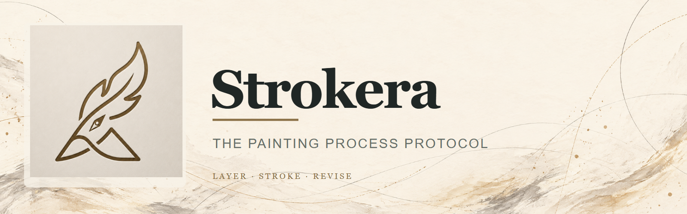

<p align="center">
  
</p>


<h1 align="center">Strokera</h1>
<p align="center"><strong>Visual Fidelity · Controlled Processing · Print Reproduction · Reproducible Production</strong></p>
<p align="center"><em>From photographic references to verifiable, print-ready visual assets.</em></p>

<p align="center">
  <a href="#vision">Vision</a> ·
  <a href="#the-production-system">Production System</a> ·
  <a href="#research-first-engineering">Research</a> ·
  <a href="#current-status">Status</a> ·
  <a href="#quick-start-existing-cli">Quick Start</a> ·
  <a href="#中文简介">中文简介</a>
</p>


> **Strokera is not another one-click AI image generator.** It is an open, research-driven foundation for transforming visual ideas into **traceable, controllable, and physically reproducible artwork**. Generative AI helps propose images; experiments evaluate processing methods; software executes validated methods; people make the final creative and production decisions.

## Vision

**Image generation is only the beginning.** A beautiful image on a screen is not yet a reliable production asset. Between a photographic reference and a finished print lie difficult problems: keeping a garment unchanged, preserving the intent of a line, removing a subject without inventing fabric, preparing edges and colors for print, and repeating the same production decisions across thousands of assets.

Strokera focuses its long-term research on five foundations:

| Foundation                  | The question we work on                                      |
| --------------------------- | ------------------------------------------------------------ |
| **Visual fidelity**         | Did the image preserve what matters in the original — silhouette, pose, clothing, details, and composition? |
| **Controlled processing**   | Can the artist inspect, modify, approve, and constrain each transformation rather than accept an opaque result? |
| **Print reproduction**      | Can screen artwork be reliably prepared, checked, proofed, and reproduced on physical media? |
| **Process reproducibility** | Can a production run be traced to its source, model or algorithm, settings, reviews, and output versions? |
| **Character identity & creative transformation** | Can the same recognizable character IP inhabit genuinely new poses, costumes, professions, scenes, and stories without identity drift? |

**Our principle: AI creates possibilities. Measurement establishes evidence. Engineering makes good results repeatable. Artists decide what is worth making.**

## Creative directions

The initial production system is built around fashion-oriented visual work. In source-fidelity workflows, each direction is a **separate branch derived from an authorized original photographic reference**. Character-IP creative work instead starts from an authorized, approved **identity reference set**. Generated outputs are never silently recycled as new originals.

### 01 · Minimalist Fashion Line Art

Translate photography into economical, expressive fashion lines and negative space, while respecting the original pose, body proportions, garment silhouette, seams, accessories, and visual identity. Background removal and editable layers are important downstream capabilities.

### 02 · American-Style Doodle & Editorial Composition

Develop a distinctive composition from an approved visual base, with graphic lines, plants, fashion objects, and local visual references. Decorative elements should remain independently editable so they do not overwrite protected subject or garment details.

### 03 · Floating Garment Studies

Remove the person from a fashion photograph while retaining **the visible garment's original structure, placement, folds, and accessories**. Unknown or hidden regions must be identified as inferred, left unresolved, or reviewed by a human — never presented as an exact reconstruction without evidence.

### 04 · Character-IP Creative Transformation (proposed)

**Preserve the character's identity, not the source image's pose, costume, or scene.** This is a separate `IDENTITY_CREATIVE` mode: protect recognizable facial and character-defining traits while deliberately reimagining gestures, occupations, wardrobe, scenes and storytelling. A quant researcher on a racing bicycle, for example, should be a genuine new character composition—not a static portrait with financial icons added around it.

Do not confuse this with the stricter `SOURCE_FIDELITY` mode needed for garment/photographic reconstruction. **Identity Consistency × Creative Transformation (ICCT)** is a dual evaluation objective, with independent human reviews for identity preservation and meaningful creativity. Read the proposed [ICCT Character-IP Protocol](docs/IDENTITY_CREATIVE_TRANSFORMATION_PROTOCOL.md); scoring and generative workflows are **not yet implemented**.

These are starting production applications, not limits on the protocol or future artistic practices.

## The production system

```text
Licensed photographic reference
       │  rights check · source hash · immutable original
       ▼
Creative direction (artist + ChatGPT or other authorized tools)
       │  independently produced concepts and approved drafts
       ▼
Reference-aware preparation
       │  masks · layers · subject/garment landmarks
       ▼
Strokera processing engine  ───────────────┐
       │  validated algorithms            │
       │  CPU / AWS GPU when useful        │
       ▼                                    │
Quality gates                               │
       │  source fidelity · edge quality   │
       │  provenance · print constraints   │
       ▼                                    │
Approved master & print preflight           │
       │  raster/vector output · ICC       │
       │  physical proof · human approval  │
       ▼                                    │
Archival asset + production record          │
                                            │
MATLAB research loop ── measured findings ─┘
  test → compare → validate → specify → implement → regress
```

### Two loops, one system

- **Production loop:** ingest → create → process → verify → print → archive.
- **Research loop:** observe failures → design MATLAB experiments → compare against baselines → implement proven methods in production code → measure again.

MATLAB is an **experimental laboratory**, not a mandatory runtime dependency for every image. Deployed algorithms may be implemented in Python, OpenCV, PyTorch, or another suitable stack after validation. GPU resources are used where they provide measurable value; not every transformation requires a GPU.

### A source of truth for every asset

A production record should preserve:

- A source file identifier, checksum, and authorization status.
- The creative branch, draft identifier, tool or model information when available, and recorded instructions.
- Processing algorithm versions, parameter sets, masks, and intermediate artifacts.
- Quality measurements, review decisions, print specifications, and approved outputs.

**Reproducible processing does not imply deterministic generative AI.** If an upstream model cannot reproduce exactly the same draft, Strokera keeps that approved draft as an immutable input for subsequent controlled processing. Every later transformation should be independently repeatable where technically feasible.

## Research-first engineering

We do not treat an attractive demonstration as sufficient evidence for a production algorithm. The research workflow is **hypothesis → controlled comparison → measurement → human review → implementation → regression test**.

Initial MATLAB research tracks (proposed):

| Research track | Focus                                                        |
| -------------- | ------------------------------------------------------------ |
| `LINE`         | Fine-line integrity, continuity, minimum printable stroke width, and vectorization artifacts |
| `MASK`         | Subject/background separation, transparent-edge halos, and alpha-matte quality |
| `GARMENT`      | Garment geometry, landmark displacement, silhouette fidelity, and detail preservation |
| `UPSCALE`      | Resolution enhancement without fabricated seams, textures, or garment features |
| `IDENTITY`     | Character identity continuity across poses, costumes and camera angles (proposed) |
| `CREATIVE`     | Evaluate meaningful creative change independently of identity continuity (proposed) |
| `PRINT`        | Physical-size resolution, color profiles, proofing, media behavior, and output validation |

Experiments should save source hashes, code and environment versions, parameters, baselines, metrics, visual comparisons, and a clear accepted/rejected conclusion. Metrics support decisions; they do not replace artistic judgment.

## Architecture: protocol + pipeline

Strokera retains its original **Strokera Painting Protocol (SPP)** as a core research and interoperability asset.

```text
Visual production job
 ├─ Source image + rights/provenance record
 ├─ Approved raster draft(s), masks, and regions
 ├─ Optional SPP painting document
 │    └─ canvas → ordered layers → ordered strokes
 ├─ Versioned processing plan + experiment references
 └─ Output masters, preflight checks, and QC report
```

**SPP defines an editable painting process**, not an entire production job. The existing `spp/0.1` contract remains stable. A separate, versioned **production manifest** is proposed for photography lineage, raster layers, processing jobs, and print requirements. Future SPP versions may extend stroke expressiveness, but must not misrepresent current `spp/0.1` capabilities.

This separation makes it possible to work with both high-resolution raster assets and inspectable stroke-based artworks without flattening the entire creative process into an untraceable image.

## Current status

**Status: early-stage protocol implementation; industrial image/print pipeline is a proposed R&D direction.**

| Capability                                                   | Status                                        |
| ------------------------------------------------------------ | --------------------------------------------- |
| `spp/0.1` document validation                                | **Available**                                 |
| Deterministic sampling of supported path / parametric strokes | **Available**                                 |
| SVG rendering from SPP documents                             | **Available**                                 |
| Self-contained HTML sequence preview                         | **Available**                                 |
| Earlier image-analysis / stroke-planning prototypes          | **Experimental; not integrated with SPP CLI** |
| Photography-to-fashion-art workflow automation               | **Planned**                                   |
| MATLAB image-fidelity and print experiments                  | **Planned**                                   |
| Production manifests, provenance, and quality gates          | **Planned**                                   |
| AWS GPU workers and scalable batch processing                | **Planned**                                   |
| ICC-managed print preflight and physical proof workflow      | **Planned**                                   |

The historical design in [`ARCHITECTURE.md`](ARCHITECTURE.md) describes earlier explorations, **not** the current implemented runtime. See [`docs/SPP-0.1.md`](docs/SPP-0.1.md) for the current protocol and [`docs/PROJECT.md`](docs/PROJECT.md) for the initial charter.

## Quick start (existing CLI)

Requires Python 3.10+.

```bash
python -m pip install -e .

# Check a painting protocol document
strokera validate examples/river-study.json

# Render ordered strokes to SVG
strokera render examples/river-study.json -o river.svg

# Create a local HTML drawing-sequence preview
strokera preview examples/river-study.json -o river.html
```

The existing CLI validates SPP documents and exports SVG/HTML. **It does not currently run ChatGPT image transformations, MATLAB experiments, AWS GPU jobs, or print preflight.** Successful commands return machine-readable JSON to stdout; validation and I/O failures return JSON to stderr with exit code `2`.

## Roadmap

Roadmap items describe **intent**, not released features; priorities may change based on experiment results.

- **R0 — Preserve the foundation:** maintain SPP 0.1, CLI behavior, regression tests, and protocol documentation.
- **R1 — Create the evidence layer:** establish a small, rights-cleared benchmark set, image/garment annotations, MATLAB experiments, and human-reviewed quality standards.
- **R2 — Build controlled image operations:** add a separate production manifest, mask/line/geometry checks, repeatable algorithms, and provenance reports.
- **R3 — Scale production on AWS:** introduce versioned CPU/GPU workers, S3 artifact storage, job logs, cost tracking, and batch orchestration where justified.
- **R4 — Validate print delivery:** integrate output preflight, device/media-specific color-management workflows, print proofs, and repeatable release criteria.

**Initial validation target:** start with approximately 20 rights-cleared photographic originals, evaluate each branch independently, then expand only after fidelity, handling time, rework rate, and print outcomes are measured.

## Print is a physical process

“Print-ready” is **a verified property of a specific output and printing context**, not a label automatically earned by upscaling an image. A production profile should declare intended physical dimensions, effective pixel density for raster materials, bleed when needed, expected substrate and printer conditions, and a suitable ICC/output profile. Final acceptance requires the relevant preflight checks and, where appropriate, a physical proof.

A useful experimental reference is **300 PPI at intended print dimensions** for appropriate raster jobs; it is not a universal rule, and setting DPI metadata alone does not create missing detail. Vector geometry, line thickness, paper behavior, and printer requirements need separate evaluation.

## Design principles

1. **Preserve the original.** Never modify or replace a rights-cleared source photograph in place.
2. **One reference, independent branches.** Avoid cumulative drift from repeatedly transforming previously generated images.
3. **Apply mode-specific constraints.** In `SOURCE_FIDELITY` preserve locked geometry and garments; in `IDENTITY_CREATIVE` preserve approved character identity while explicitly allowing new poses, costumes, scenes and roles.
4. **Separate observation from invention.** Identify inferred areas and generated details, especially in garment reconstruction.
5. **Record the process.** Keep edits, parameters, approvals, and versioned outputs inspectable.
6. **Test before scaling.** Promote algorithms into production only with baselines, measurable evidence, and regression coverage.
7. **Keep artists in control.** Automation proposes and processes; responsible humans approve.
8. **Deliver the physical result.** Judge a print pipeline by actual output, not merely screen appearance.

## Repository guide

| Location                                                     | Purpose                                                      |
| ------------------------------------------------------------ | ------------------------------------------------------------ |
| [`src/strokera/protocol.py`](src/strokera/protocol.py)       | Current SPP validation and SVG rendering                     |
| [`src/strokera/protocol_cli.py`](src/strokera/protocol_cli.py) | Current command-line interface                               |
| [`docs/SPP-0.1.md`](docs/SPP-0.1.md)                         | Implemented protocol contract                                |
| [`docs/PROJECT.md`](docs/PROJECT.md)                         | Original charter and SPP milestones                          |
| [`docs/IDENTITY_CREATIVE_TRANSFORMATION_PROTOCOL.md`](docs/IDENTITY_CREATIVE_TRANSFORMATION_PROTOCOL.md) | Proposed character-IP creative transformation and evaluation protocol |
| [`examples/`](examples/)                                     | Runnable SPP examples                                        |
| [`tests/`](tests/)                                           | Existing tests                                               |
| [`src/strokera/core/`](src/strokera/core/) · [`planning/`](src/strokera/planning/) · [`optimize/`](src/strokera/optimize/) | Older research modules; not yet part of the new protocol CLI |

Future research, production-worker, and preflight directories will be introduced through reviewed changes rather than represented here as already existing.

## 中文简介

**Strokera｜视觉保真与印刷生产基础设施**

Strokera 的长期技术核心，不是单独的图像生成，而是：

> **视觉保真、可控加工、印刷还原，以及整个创作过程的可重复性。**

以具有合法使用权的摄影图片为起点，由艺术家与 ChatGPT 等创作工具提出视觉方案，逐张独立生成**极简时尚线描、美式涂鸦、悬空服装设计**等方向；通过 MATLAB 建立研究与实验体系，验证图像保真、蒙版质量、服装结构、分辨率增强和印刷表现；再将成熟算法实现为可测试的软件模块，根据实际需求在本地 CPU 或 AWS GPU 上执行，并通过质量检查、印刷打样和版本化归档交付作品。

这是一条 **创作 → 实验 → 工程 → 生产 → 证据反馈** 的长期发展路线。现阶段仓库已经具备 SPP 0.1 绘画协议、SVG 渲染和 HTML 回放功能；完整的 MATLAB、AWS 和印刷生产体系仍在规划研发中。

**AI 提供创作可能，科学实验提供证据，工程把经过验证的方法变成可重复的工业能力。**

## License & responsible use

The repository is licensed under **[GPL-3.0-only](LICENSE)**. This license applies to repository code; it **does not grant rights to third-party photographs, artworks, trademarks, model weights, or generated assets**. Contributors and users are responsible for obtaining necessary permissions, protecting personal images, and checking licenses and terms before integrating external models, datasets, or tools.

---

<p align="center"><strong>Strokera — Make images intentional. Make processes measurable. Make artwork reproducible.</strong></p>
